# 🏠 Mon Homelab Personnel sous OpenMediaVault (OMV)

Bienvenue dans la documentation de mon infrastructure **Homelab**. Ce serveur personnel fonctionne sous **OpenMediaVault (Debian)** avec une grappe de stockage de **12 To utiles en RAID 5**, orchestré par **Docker** et **Docker Compose**.

Il centralise l'ensemble de mes services domotiques, multimédias, cloud privé, outils d'administration et supervision réseau dans un environnement cloisonné, rapide et hautement sécurisé.

---

## 🧭 Sommaire

- [Vue d'ensemble & Architecture](#-vue-densemble--architecture)
- [📚 Guides & Documentation Détaillée (`docs/`)](#-guides--documentation-détaillée-docs)
- [📖 Guide des Services](#-guide-des-services)
  - [1. Domotique, IoT & IA Vocale Locale](#1-domotique-iot--ia-vocale-locale)
  - [2. Streaming & Multimédia (Servarr Stack)](#2-streaming--multimédia-servarr-stack)
  - [3. Cloud Personnel, Photos & Mots de passe](#3-cloud-personnel-photos--mots-de-passe)
  - [4. Réseau, Administration & Monitoring](#4-réseau-administration--monitoring)
- [🗂 Organisation des Stacks Docker](#-organisation-des-stacks-docker)
- [🔒 Principes de Sécurité Essentiels](#-principes-de-sécurité-essentiels)

---

## 🏗 Vue d'ensemble & Architecture

L'infrastructure s'articule autour d'un modèle **"Zéro Port Exposé"** : tous les conteneurs sont isolés dans un réseau privé virtuel Docker nommé `proxy`. Seul le Reverse Proxy Nginx Proxy Manager écoute sur les ports `80` et `443` avec certificats SSL Let's Encrypt automatisés.

```mermaid
flowchart TB
    subgraph WAN ["🌐 Extérieur & Réseau Local (LAN)"]
        User["Utilisateur / Navigateur / Mobile"]
    end

    subgraph Host ["🖥️ Serveur Hôte OpenMediaVault (Debian)"]
        subgraph Hardware ["💾 Stockage Physique"]
            SSD["SSD 480 Go\nOS OMV + Docker Runtime"]
            RAID["Grappe RAID 5 (12 To Utiles)\n4x HDD 4 To (/dev/md0)"]
        end

        subgraph Ports_Exposes ["Ports Exposés sur l'Hôte"]
            P_NPM["Ports 80 / 443 (HTTP / HTTPS)"]
            P_BT["Port 51413 (Transmission P2P)"]
            P_MQTT["Port 1883 (Mosquitto MQTT LAN)"]
            P_PP["Port 5657 (PufferPanel SFTP)"]
        end

        subgraph DockerNetwork ["🔒 Réseau Privé Docker Interne : 'proxy' (Bridge Virtuel)"]
            NPM["Nginx Proxy Manager\n(Reverse Proxy & SSL Let's Encrypt)"]

            subgraph Stack_Media ["Multimédia & Téléchargement"]
                Jellyfin["Jellyfin (8096)"]
                Jellyseerr["Jellyseerr (5055)"]
                Arr["Radarr (7878) / Sonarr (8989)\nLidarr (8686) / Readarr (8787)"]
                Prowlarr["Prowlarr (9696)"]
                Transmission["Transmission (9091)"]
                Flare["Flaresolverr (8191)"]
            end

            subgraph Stack_Cloud ["Cloud & Données"]
                Nextcloud["Nextcloud (80)"]
                MariaDB["MariaDB (3306)"]
                Collabora["Collabora Online (9980)"]
                PhotoPrism["PhotoPrism (2342)"]
                Vaultwarden["Vaultwarden (80)"]
            end

            subgraph Stack_Home ["Domotique & Voix"]
                HA["Home Assistant (8123)"]
                Z2M["Zigbee2MQTT (8080)"]
                Mosquitto["Mosquitto (1883)"]
                ESPHome["ESPHome (6052)"]
                Wyoming["Wyoming Piper / Whisper / WakeWord"]
            end

            subgraph Stack_Ops ["Administration & Monitoring"]
                Kuma["Uptime Kuma (3001)"]
                Homepage["Homepage (3000)"]
                Portainer["Portainer (9000)"]
                SockProxy["Docker Socket Proxy (2375)"]
                Watchtower["Watchtower"]
                Puffer["PufferPanel (8080)"]
            end
        end
    end

    %% Stockage vers conteneurs
    RAID -.->|Volumes persistants| Stack_Media
    RAID -.->|Données & Photos| Stack_Cloud

    %% Flux réseau
    User -->|Requêtes HTTPS| P_NPM --> NPM
    User -.->|Trafic Torrent P2P| P_BT --> Transmission
    User -.->|Capteurs IoT locaux| P_MQTT --> Mosquitto
    User -.->|Connexion Jeux / SFTP| P_PP --> Puffer

    %% Routage NPM via le réseau interne
    NPM -->|http://jellyfin:8096| Jellyfin
    NPM -->|http://nextcloud:80| Nextcloud
    NPM -->|http://vaultwarden:80| Vaultwarden
    NPM -->|http://homeassistant:8123| HA
    NPM -->|http://homepage:3000| Homepage
    NPM -->|http://jellyseerr:5055| Jellyseerr
    NPM -->|http://uptime-kuma:3001| Kuma
    NPM -->|http://photoprism:2342| PhotoPrism
    NPM -->|http://collabora:9980| Collabora
```

---

## 📚 Guides & Documentation Détaillée (`docs/`)

Pour approfondir chaque aspect de l'infrastructure, consultez les guides modulaires dédiés :

| Guide | Description & Contenu |
| :--- | :--- |
| [**1. Stockage & RAID 5 OpenMediaVault**](docs/1-storage-raid.md) | Spécifications des disques, fonctionnement du RAID 5 sous Linux (`mdadm`), tolérance aux pannes et arborescence de stockage `/srv/.../media`. |
| [**2. Réseau, Zéro Port & Split-DNS**](docs/2-network-dns.md) | Fonctionnement du réseau bridge virtuel `proxy`, configuration registrar (IP fixe/DDNS), réécriture DNS locale dans AdGuard Home et domaines `.home`/`.local`. |
| [**3. Interconnexion Servarr (Streaming 4K)**](docs/3-servarr-workflow.md) | Workflow complet et automatisé : de la demande sur Jellyseerr au téléchargement Transmission et à la diffusion Jellyfin via Prowlarr et Radarr/Sonarr. |
| [**4. Sécurisation & Hardening Système**](docs/4-security-hardening.md) | Clés SSH Ed25519, désactivation des mots de passe, mises à jour automatiques Debian (`unattended-upgrades`), pare-feu socket Docker, Fail2ban et règle de sauvegarde 3-2-1. |
| [**5. Tutoriel de Déploiement**](docs/5-deployment-guide.md) | Procédure pas-à-pas pour reconstruire tout le serveur de A à Z ou déployer un module isolé (uniquement le multimédia, la domotique ou Vaultwarden). |
| [**6. Serveur Minecraft & PufferPanel**](docs/6-minecraft-pufferpanel.md) | Déploiement d'un serveur Minecraft optimisé (Paper), acceptation EULA, redirection NAT port 25565 et enregistrements DNS (`mc.mondomaine.com` en A/CNAME et SRV). |
| [**7. Cerveau IA Local J.A.R.V.I.S.**](docs/7-jarvis-ai-brain.md) | Architecture et déploiement d'Ollama, Open WebUI, n8n, réécritures DNS locales AdGuard (*.jarvis.local), RAG Nextcloud et intégration Assist Home Assistant. |
| [**8. VPN Mesh Tailscale & Subnet Router**](docs/8-tailscale-vpn.md) | Accès distant d'administration chiffré (WireGuard), routage du sous-réseau local `192.168.1.0/24` (Subnet Router), mode Exit Node et zéro port ouvert. |
| [**9. Détection d'Intrusions & Bannissement IP (CrowdSec)**](docs/9-crowdsec-security.md) | Analyse en temps réel des journaux NPM et SSH, blocage automatique des bots malveillants via le pare-feu Linux (nftables). |
| [**10. Authentification Unique SSO & 2FA (Authelia)**](docs/10-authelia-sso-2fa.md) | Portail d'accès unifié, double authentification (TOTP) et Passkeys WebAuthn protégeant les interfaces d'administration. |

---

## 📖 Guide des Services

### 1. Domotique, IoT & IA Vocale Locale

| Service | Port interne | Description technique & Rôle |
| :--- | :---: | :--- |
| **Home Assistant** | `8123` | **Plateforme domotique centralisée** : Gestion des équipements connectés, exécution des scénarios d'automatisation locale et tableau de bord de supervision. |
| **Zigbee2MQTT** | `8080` | **Passerelle Zigbee vers MQTT** : Pont matériel reliant les périphériques radio Zigbee (capteurs, actionneurs) au bus MQTT sans passerelle propriétaire. |
| **Mosquitto** | `1883` | **Broker MQTT** : Bus de messages léger assurant l'échange asynchrone des flux de données entre capteurs, passerelles et Home Assistant. |
| **ESPHome** | `6052` | **Environnement de compilation et flash microcontrôleurs** : Génération et téléversement de firmwares sur-mesure sur puces ESP32 / ESP8266 à partir de fichiers YAML. |
| **Wyoming Whisper** | `10300` | **Reconnaissance vocale locale (STT)** : Transcription audio en texte exécutée localement sur le processeur hôte sans dépendance cloud. |
| **Wyoming Piper** | `10200` | **Synthèse vocale locale (TTS)** : Génération audio de voix française fluide à faible latence à partir de modèles neuronaux optimisés. |
| **Wyoming OpenWakeWord** | `10400` | **Détection de mot-clé (Wake Word)** : Détection continue du mot d'activation en local sur le processeur sans transfert de flux audio externe. |
| **Ollama** | `11434` | **Moteur d'exécution LLM local** : Inférence de modèles de langage (Qwen2.5, Llama) et d'embeddings avec accélération iGPU. |
| **Open WebUI** | `8080` | **Interface d'interaction et RAG** : Chat web avec indexation vectorielle des documents Nextcloud via nomic-embed-text. |
| **n8n** | `5678` | **Moteur d'automatisation et orchestrateur d'API** : Exécution de workflows nodaux et connecteurs WebDAV / MCP pour J.A.R.V.I.S. |

---

### 2. Streaming & Multimédia (Servarr Stack)

| Service | Port interne | Description technique & Rôle |
| :--- | :---: | :--- |
| **Jellyfin** | `8096` | **Serveur multimédia et transcodage** : Diffusion et indexation de bibliothèques vidéo et musicales avec accélération matérielle Intel QuickSync. |
| **Jellyseerr** | `5055` | **Portail de requêtes multimédias** : Interface utilisateur pour la recherche et la formulation de demandes de contenus, interfacée aux API Radarr et Sonarr. |
| **Radarr** | `7878` | **Gestionnaire de films** : Surveillance, recherche automatisée et organisation des fichiers de films selon des profils de qualité prédéfinis. |
| **Sonarr** | `8989` | **Gestionnaire de séries TV** : Suivi des saisons, planification des épisodes et automatisation des téléchargements associés. |
| **Lidarr** | `8686` | **Gestionnaire de musique** : Suivi des discographies d'artistes et organisation des bibliothèques audio. |
| **Readarr** | `8787` | **Gestionnaire de livres** : Gestion automatisée de collections d'e-books et de livres audio. |
| **Prowlarr** | `9696` | **Gestionnaire d'indexeurs** : Centralisation des trackers BitTorrent et synchronisation bidirectionnelle des configurations vers Radarr, Sonarr et Lidarr. |
| **Transmission** | `9091` | **Client BitTorrent** : Démon de téléchargement P2P gérant le transfert effectif des flux vers le stockage RAID 5. |
| **FlareSolverr** | `8191` | **Proxy de résolution anti-bot** : Résolution automatisée des vérifications Cloudflare pour permettre l'indexation par Prowlarr. |

---

### 3. Cloud Personnel, Photos & Mots de passe

| Service | Port interne | Description technique & Rôle |
| :--- | :---: | :--- |
| **Nextcloud** | `80` | **Plateforme collaborative et stockage cloud** : Synchronisation de fichiers, contacts, agendas et documents avec authentification multifacteur (2FA). |
| **MariaDB (Nextcloud)** | `3306` | **Base de données relationnelle** : Stockage transactionnel des index, partages et métadonnées de l'instance Nextcloud. |
| **Collabora Online** | `9980` | **Moteur bureautique en ligne** : Édition collaborative en temps réel de documents Office (DOCX, XLSX, PPTX) intégrée à Nextcloud. |
| **PhotoPrism** | `2342` | **Gestionnaire de photothèque** : Indexation d'images avec analyse de métadonnées EXIF, géolocalisation et classification visuelle assistée par modèles de vision. |
| **PhotoPrism DB** | `3306` | **Base de données MariaDB** : Stockage des tables d'indexation, coordonnées GPS et métadonnées de la galerie PhotoPrism. |
| **Vaultwarden** | `80` | **Serveur de coffre-fort de mots de passe** : Implémentation compatible avec les clients Bitwarden, chiffrée de bout en bout et protégée par 2FA. |

---

### 4. Réseau, Administration & Monitoring

| Service | Port interne | Description technique & Rôle |
| :--- | :---: | :--- |
| **Nginx Proxy Manager** | `80 / 443 / 81` | **Reverse Proxy HTTP/HTTPS** : Terminaison SSL avec renouvellement automatisé Let's Encrypt et routage des requêtes vers les conteneurs du réseau bridge. |
| **AdGuard Home** | `53 / 3000` | **Serveur DNS local et filtrage** : Résolution DNS récursive, blocage des publicités/traqueurs et réécritures locales (Split-DNS). |
| **Uptime Kuma** | `3001` | **Supervision de disponibilité (Monitoring)** : Vérification périodique des services réseau (HTTP, TCP, DNS) avec alertes en cas d'interruption. |
| **Portainer CE** | `9000 / 9443` | **Interface d'administration Docker** : Gestion visuelle des conteneurs, réseaux, volumes et inspection des journaux d'exécution. |
| **Docker Socket Proxy** | `2375` | **Proxy d'accès au socket Docker** : Restriction granulaire des requêtes API Docker autorisées, protégeant le démon hôte contre les privilèges excessifs. |
| **Homepage** | `3000` | **Tableau de bord applicatif** : Portail d'accueil statique et léger affichant l'état des services et des indicateurs temps réel via API. |
| **PufferPanel** | `8080 / 5657` | **Gestionnaire de serveurs de jeux** : Orchestration de conteneurs pour serveurs de jeu (Minecraft Java/Bedrock) avec console web et serveur SFTP intégré. |
| **Watchtower** | `8080` | **Mise à jour automatisée de conteneurs** : Scrutation périodique des registres d'images et redéploiement contrôlé des conteneurs ciblés. |
| **Tailscale** | `Host / VPN` | **Passerelle VPN Mesh & Subnet Router** : Tunnel WireGuard chiffré reliant vos appareils mobiles au sous-réseau local (`192.168.1.0/24`) et mode Exit Node sans ouvrir aucun port. |
| **CrowdSec** | `LAPI / Host` | **Système de détection d'intrusions (IDS/IPS)** : Analyse comportementale des logs Nginx et SSH avec bannissement automatique dans le pare-feu de l'hôte. |
| **Authelia** | `9091` | **Serveur d'authentification SSO & 2FA** : Passerelle de contrôle d'accès protégeant les sous-domaines sensibles par double facteur TOTP ou Passkey. |

---

## 🗂 Organisation des Stacks Docker

Toutes les configurations `docker-compose.yml` ont été assainies (secrets et domaines masqués) et sont classées dans le dossier [`stacks/`](stacks/) :

| Stack | Dossier du dépôt | Services inclus | Exposition recommandée |
| :--- | :--- | :--- | :---: |
| **arr** | [`stacks/arr/`](stacks/arr/docker-compose.yml) | `lidarr`, `sonarr`, `radarr`, `readarr` | 🔒 **Local / VPN** |
| **jellyfin** | [`stacks/jellyfin/`](stacks/jellyfin/docker-compose.yml) | `jellyfin` | 🌐 **Public (HTTPS)** |
| **jellyseerr** | [`stacks/jellyseerr/`](stacks/jellyseerr/docker-compose.yml) | `jellyseerr` | 🌐 **Public (HTTPS)** |
| **transmission** | [`stacks/transmission/`](stacks/transmission/docker-compose.yml) | `transmission` | 🔒 **Local / VPN** *(Port P2P 51413 ouvert)* |
| **prowlarr** | [`stacks/prowlarr/`](stacks/prowlarr/docker-compose.yml) | `prowlarr` | 🔒 **Local / VPN** |
| **flaresolverr** | [`stacks/flaresolverr/`](stacks/flaresolverr/docker-compose.yml) | `flaresolverr` | 🔒 **Local interne** |
| **homeauto** | [`stacks/homeauto/`](stacks/homeauto/docker-compose.yml) | `homeassistant`, `zigbee2mqtt`, `mosquitto` | ⚠️ **Public (2FA)** ou **VPN** |
| **wyoming** | [`stacks/wyoming/`](stacks/wyoming/docker-compose.yml) | `wyoming-piper`, `wyoming-whisper`, `wyoming-openwakeword` | 🔒 **Local interne** |
| **esphome** | [`stacks/esphome/`](stacks/esphome/docker-compose.yml) | `esphome` | 🔒 **Local / VPN** |
| **nextcloud** | [`stacks/nextcloud/`](stacks/nextcloud/docker-compose.yml) | `nextcloud`, `mariadb` | 🌐 **Public (HTTPS + 2FA)** |
| **collabora** | [`stacks/collabora/`](stacks/collabora/docker-compose.yml) | `collabora` | 🌐 **Public (HTTPS)** |
| **photoprism** | [`stacks/photoprism/`](stacks/photoprism/docker-compose.yml) | `photoprism`, `photoprism-db` | 🌐 **Public (HTTPS)** |
| **vaultwarden** | [`stacks/vaultwarden/`](stacks/vaultwarden/docker-compose.yml) | `vaultwarden` | 🌐 **Public (HTTPS + 2FA)** |
| **nginx-proxy-manager** | [`stacks/nginx-proxy-manager/`](stacks/nginx-proxy-manager/docker-compose.yml) | `proxy` | 🌐 **Ports 80/443 Publics** *(Admin 81 en Local)* |
| **docker-socket-proxy** | [`stacks/docker-socket-proxy/`](stacks/docker-socket-proxy/docker-compose.yml) | `docker-proxy` | 🔒 **Local interne** |
| **adguard** | [`stacks/adguard/`](stacks/adguard/docker-compose.yml) | `adguardhome` | 🔒 **Local / LAN** |
| **uptime-kuma** | [`stacks/uptime-kuma/`](stacks/uptime-kuma/docker-compose.yml) | `uptime-kuma` | ⚠️ **Page Statut Publique** *(Admin en Local)* |
| **homepage** | [`stacks/homepage/`](stacks/homepage/docker-compose.yml) | `homepage` | 🔒 **Local / VPN** |
| **pufferpanel** | [`stacks/pufferpanel/`](stacks/pufferpanel/docker-compose.yml) | `pufferpanel` | ⚠️ **Public (Jeux)** *(Admin restreint)* |
| **watchtower** | [`stacks/watchtower/`](stacks/watchtower/docker-compose.yml) | `watchtower` | 🔒 **Local interne** |
| **portainer-ce** | [`stacks/portainer-ce/`](stacks/portainer-ce/docker-compose.yml) | `portainer` | 🔒 **Local / VPN** |
| **jarvis** | [`stacks/jarvis/`](stacks/jarvis/docker-compose.yml) | `ollama`, `open-webui`, `n8n` | 🔒 **Local / VPN** *(Ports 8080/5678 via NPM)* |
| **tailscale** | [`stacks/tailscale/`](stacks/tailscale/docker-compose.yml) | `tailscale` | 🔒 **VPN Privé** *(Réseau Host)* |
| **crowdsec** | [`stacks/crowdsec/`](stacks/crowdsec/docker-compose.yml) | `crowdsec` | 🔒 **Local / Interne** |
| **authelia** | [`stacks/authelia/`](stacks/authelia/docker-compose.yml) | `authelia` | 🌐 **Public (HTTPS via NPM)** |

---

## 🔒 Principes de Sécurité Essentiels

1. **Variables d'environnement :** Toujours externaliser les mots de passe et clés d'API dans un fichier `.env` non versionné, et ne partager que des fichiers `.env.example`.
2. **Cloisonnement réseau :** N'exposer sur Internet que les ports 80/443 du Reverse Proxy avec certificat SSL. Accéder aux panneaux d'administration (Portainer, PufferPanel, etc.) via un VPN privé (WireGuard/Tailscale).
3. **Mots de passe & MFA :** Activer systématiquement la double authentification (2FA) sur Vaultwarden, Nextcloud et Home Assistant.
4. **Sauvegarde 3-2-1 :** Rappelez-vous que le RAID 5 protège de la panne physique, mais ne remplace pas une vraie sauvegarde externe hors-site.
5. **Hygiène Système & Logs :** Limiter la taille des logs Docker via `/etc/docker/daemon.json` ([`scripts/setup_docker_log_rotation.sh`](scripts/setup_docker_log_rotation.sh)) pour éviter la saturation du SSD système.

Consultez le [**Guide de Hardening détaillé**](docs/4-security-hardening.md) pour les instructions complètes de sécurisation SSH et système.