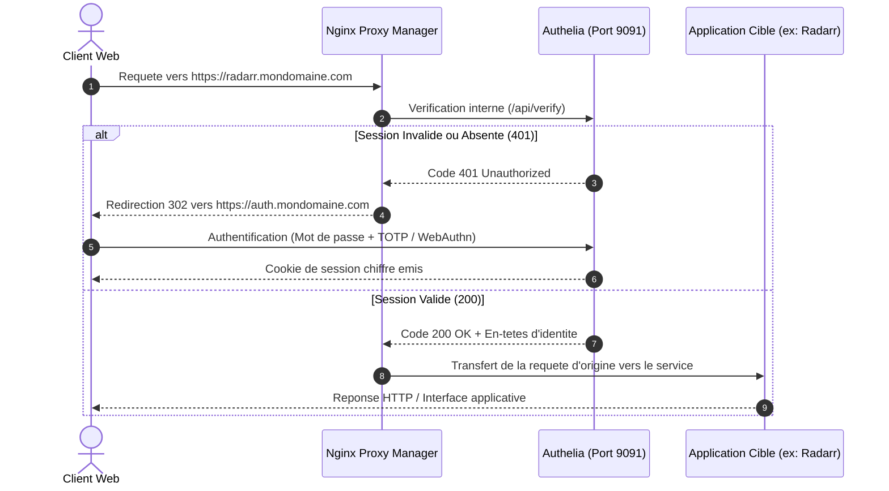

# Guide : Authentification Unique (SSO) & Double Facteur 2FA (Authelia)

Ce document décrit l'intégration d'**Authelia** avec **Nginx Proxy Manager** pour sécuriser les services web (Radarr, Sonarr, Prowlarr, Transmission, etc.) derrière une passerelle d'authentification centralisée avec **Double Authentification (TOTP)** ou **Passkey / WebAuthn**.

---

## 1. Principes et Flux d'Authentification



---

## 2. Déploiement de la Stack Authelia

La configuration se trouve dans [`stacks/authelia/`](../stacks/authelia/) :

1. Accédez au répertoire de la stack :
   ```bash
   cd /srv/docker/stacks/authelia
   ```
2. Créez le fichier d'environnement :
   ```bash
   cp .env.example .env
   ```
   Générez trois clés cryptographiques de 32 octets :
   ```bash
   openssl rand -hex 32   # AUTHELIA_JWT_SECRET
   openssl rand -hex 32   # AUTHELIA_STORAGE_ENCRYPTION_KEY
   openssl rand -hex 32   # AUTHELIA_SESSION_SECRET
   ```
3. Initialisez le fichier des utilisateurs locaux :
   ```bash
   cp config/users_database.yml.example config/users_database.yml
   ```
4. Générez l'empreinte Argon2id du mot de passe administrateur :
   ```bash
   docker run --rm -it authelia/authelia:latest authelia crypto hash generate argon2
   ```
   Renseignez le hash obtenu dans le champ `password` de l'utilisateur `admin` dans `config/users_database.yml`.

5. Adaptez `config/configuration.yml` avec votre nom de domaine réel :
   * Dans `access_control.rules` : déclarez votre portail `auth.mondomaine.com` en `bypass`, puis vos services en `two_factor`.
   * Dans `session.cookies` : renseignez votre domaine racine et l'URL publique de votre portail :
     ```yaml
     session:
       cookies:
         - domain: "mondomaine.com"
           authelia_url: "https://auth.mondomaine.com"
           default_redirection_url: "https://mondomaine.com"
     ```

6. Démarrez le service :
   ```bash
   docker compose up -d
   ```

---

## 3. Configuration Nginx Proxy Manager (NPM)

### Étape A : Déclaration du portail Authelia (`auth.mondomaine.com`)

1. Dans NPM > **Proxy Hosts** > **Add Proxy Host** :
   * **Domain Names** : `auth.mondomaine.com`
   * **Forward Hostname / IP** : `authelia`
   * **Forward Port** : `9091`
   * **Block Common Exploits** : activé
   * **Websockets Support** : activé
2. Onglet **SSL** :
   * Certificat : Let's Encrypt valide
   * **Force SSL** : activé
3. Enregistrez.

---

### Étape B : Protection d'un service (Exemple : `radarr.mondomaine.com`)

Pour assujettir un sous-domaine au contrôle d'accès d'Authelia :

1. Dans NPM, modifiez la fiche d'hôte du service cible (`radarr.mondomaine.com`).
2. Ouvrez l'onglet **Advanced** (configuration Nginx personnalisée).
3. Insérez le bloc de directives suivant :

```nginx
# 1. Resolveur DNS interne Docker (permet la resolution de l'hote "authelia")
resolver 127.0.0.11 valid=30s;

# 2. Sous-requete de controle d'authentification
location /authelia {
    internal;
    set $upstream_authelia http://authelia:9091/api/verify;
    proxy_pass_request_body off;
    proxy_pass $upstream_authelia;
    proxy_set_header Content-Length "";

    proxy_set_header X-Original-URL $scheme://$http_host$request_uri;
    proxy_set_header X-Real-IP $remote_addr;
    proxy_set_header X-Forwarded-Method $request_method;
    proxy_set_header X-Forwarded-Proto $scheme;
    proxy_set_header X-Forwarded-Host $http_host;
    proxy_set_header X-Forwarded-URI $request_uri;
    proxy_set_header X-Forwarded-For $remote_addr;
}

# 3. Transmission vers le service cible sous reserve d'authentification
location / {
    auth_request /authelia;
    auth_request_set $target_url $scheme://$http_host$request_uri;
    auth_request_set $user $upstream_http_remote_user;
    auth_request_set $groups $upstream_http_remote_groups;
    auth_request_set $name $upstream_http_remote_name;
    auth_request_set $email $upstream_http_remote_email;
    proxy_set_header Remote-User $user;
    proxy_set_header Remote-Groups $groups;
    proxy_set_header Remote-Name $name;
    proxy_set_header Remote-Email $email;

    error_page 401 =302 https://auth.mondomaine.com/?rd=$target_url;

    # Relais vers la configuration definie dans l'onglet 'Details' de NPM
    proxy_pass $forward_scheme://$server:$port;
    proxy_set_header Host $host;
    proxy_set_header X-Real-IP $remote_addr;
    proxy_set_header X-Forwarded-For $proxy_add_x_forwarded_for;
    proxy_set_header X-Forwarded-Proto $scheme;
}
```

> [!IMPORTANT]
> **Règle de portée du cookie SSO :** Le portail Authelia et les sous-domaines protégés doivent partager le même domaine racine (ex: `radarr.mondomaine.com` et `auth.mondomaine.com`). Un domaine local indépendant (ex: `.local` ou IP brute) ne peut pas recevoir le cookie de session émis sur le domaine public.

> [!WARNING]
> **Cas particulier de Vaultwarden / Bitwarden :**
> Les applications mobiles et extensions de navigateur Bitwarden synchronisent leurs coffres via des appels d'API REST directs (`/api`, `/identity`). Si Nginx intercepte ces requêtes et renvoie une redirection HTTP 302 vers la page de connexion Authelia, la synchronisation du coffre échoue sur tous les clients mobiles et navigateurs. Il est recommandé de laisser Vaultwarden gérer sa double authentification nativement (TOTP, WebAuthn/Passkey) sans filtre Authelia, ou de n'intercepter que l'interface Web en excluant les routes d'API.

---

## 4. Initialisation du Second Facteur (2FA)

1. Accédez à l'URL du portail d'authentification : `https://auth.mondomaine.com`.
2. Saisissez les identifiants définis dans `config/users_database.yml`.
3. Pour enroler un second facteur (TOTP) :
   * Consultez le fichier de notification local généré sur le serveur :
     ```bash
     cat /srv/docker/stacks/authelia/config/notification.txt
     ```
   * Ouvrez l'URL de confirmation indiquée pour afficher le QR Code de synchronisation.
   * Scannez le code avec une application d'authentification compatible (Aegis, 2FAS, Google Authenticator).
4. L'enregistrement d'une clé de sécurité matérielle (Passkey / FIDO2 / YubiKey) est également disponible depuis l'interface utilisateur.

---

## 5. Gestion Multi-Services (Wildcard) & Multi-Domaines

### A. Règle globale par joker (`*.mondomaine.com`)

Au lieu de déclarer individuellement chaque sous-domaine (`radarr`, `sonarr`, `prowlarr`, etc.) dans `access_control.rules`, vous pouvez utiliser une règle avec caractère générique (*wildcard*) :

```yaml
access_control:
  default_policy: deny
  rules:
    # 1. Le portail d'authentification lui-même (DOIT impérativement figurer en tête)
    - domain:
        - "auth.mondomaine.com"
      policy: bypass

    # 2. Règle générique appliquant le 2FA à tous les sous-domaines
    - domain:
        - "*.mondomaine.com"
      policy: two_factor
```

* **Fonctionnement** : Tout nouveau sous-domaine configuré dans Nginx Proxy Manager avec le bloc de vérification Authelia est immédiatement protégé par 2FA, sans nécessiter de redémarrage d'Authelia ni de modification de `configuration.yml`.
* **Ordre de priorité des règles** : Authelia évalue les règles de haut en bas et s'arrête à la première correspondance trouvée (*first match*). La règle `auth.mondomaine.com` avec la directive `bypass` doit impérativement précéder `*.mondomaine.com`, sans quoi le portail d'authentification s'auto-bloque lors du chargement de ses propres ressources (erreur HTTP 403).

---

### B. Architecture multi-domaines (`session.cookies`)

Depuis Authelia v4.38+, une instance unique peut sécuriser plusieurs domaines racines distincts (par exemple `mondomaine.ch` et `autre-domaine.com`) :

```yaml
session:
  name: authelia_session
  same_site: lax
  expiration: 2h
  inactivity: 15m
  remember_me: 1M
  cookies:
    # Domaine principal
    - domain: "mondomaine.ch"
      authelia_url: "https://auth.mondomaine.ch"
      default_redirection_url: "https://mondomaine.ch"

    # Deuxième domaine racine distinct
    - domain: "autre-domaine.com"
      authelia_url: "https://auth.mondomaine.ch"
      default_redirection_url: "https://autre-domaine.com"

access_control:
  default_policy: deny
  rules:
    - domain:
        - "auth.mondomaine.ch"
      policy: bypass

    - domain:
        - "*.mondomaine.ch"
        - "*.autre-domaine.com"
      policy: two_factor
```

* **Attribut `domain`** : Définit le périmètre de validité du cookie de session dans le navigateur. Par mesure de sécurité native au protocole web, un navigateur ne transmet jamais un cookie émis pour `mondomaine.ch` lors d'une requête vers `autre-domaine.com`. La liste `cookies` permet à Authelia d'émettre un jeton adapté à chaque domaine racine.
* **Attribut `authelia_url`** : URL publique du portail d'authentification vers laquelle le proxy redirige les requêtes non authentifiées de ce domaine.
* **Attribut `default_redirection_url`** : URL de repli si l'utilisateur accède au portail sans paramètre d'origine (`?rd=`).

---

[← Retour au README principal](../README.md)
