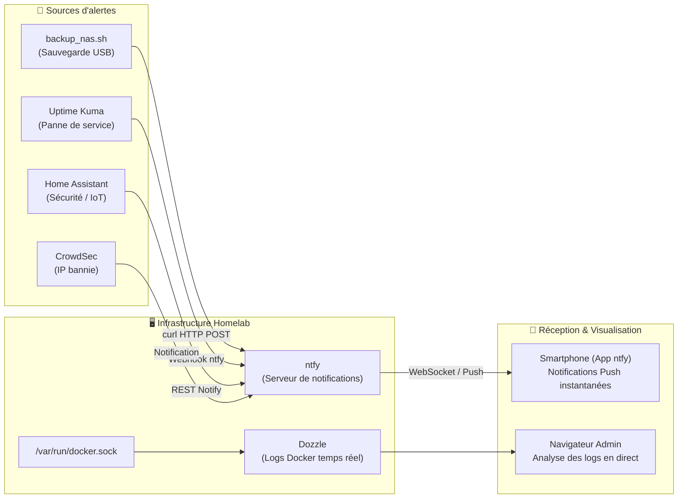

# Guide : Observabilité & Alerting Push Centralisé (ntfy & Dozzle)

Ce document décrit le déploiement de **Dozzle** (visionneuse de journaux Docker en direct) et de **ntfy** (serveur auto-hébergé de notifications push pour smartphones) au sein de votre Homelab.

---

## 1. Rôle et Architecture



* **Dozzle** : Vous évite de vous connecter en SSH pour taper `docker logs -f nom_conteneur`. Il offre une interface web réactive, avec recherche instantanée, coloration syntaxique et détection automatique des nouveaux conteneurs.
* **ntfy** : Remplace les bots Telegram ou Discord complexes. Une simple commande `curl` dans un script shell ou une automatisation suffit pour faire vibrer votre téléphone avec priorité, icônes et boutons d'action.

---

## 2. Déploiement des Stacks

Les fichiers Compose sont situés dans `stacks/dozzle/` et `stacks/ntfy/`.

### Étape 1 : Démarrer Dozzle
```bash
cd /srv/docker/stacks/dozzle
docker compose up -d
```

### Étape 2 : Démarrer ntfy
```bash
cd /srv/docker/stacks/ntfy
docker compose up -d
```

Vérifiez que les deux conteneurs tournent sans erreur :
```bash
docker ps --filter "name=dozzle" --filter "name=ntfy"
```

---

## 3. Configuration dans Nginx Proxy Manager (NPM)

Pour accéder aux interfaces de manière sécurisée :

### A. Hôte Proxy pour Dozzle (`logs.local` ou `logs.domaine.com`)
* **Forward Hostname / IP :** `dozzle`
* **Forward Port :** `8080`
* **Websockets Support :** Activé
* **Sécurité recommandée :** Protéger cette URL avec **Authelia (2FA)** car les journaux Docker peuvent afficher des données sensibles (tokens, identifiants de debug).

### B. Hôte Proxy pour ntfy (`ntfy.local` ou `ntfy.domaine.com`)
* **Forward Hostname / IP :** `ntfy`
* **Forward Port :** `80`
* **Websockets Support :** **OBLIGATOIRE (ON)** *(Nécessaire pour le push temps réel sur l'application mobile)*
* **Block Common Exploits :** Activé

---

## 4. Configuration de l'Application Mobile ntfy

1. Installez l'application **ntfy** sur votre smartphone (disponible sur Google Play Store, F-Droid et iOS App Store).
2. Ouvrez l'application, allez dans **Paramètres > Serveur par défaut** :
   * Indiquez l'URL de votre instance (ex: `https://ntfy.domaine.com` ou `http://192.168.1.3:80`).
3. Appuyez sur **+** et abonnez-vous aux canaux suivants :
   * `homelab-backups` : alertes de sauvegarde
   * `homelab-alerts` : alertes de pannes et sécurité
   * `homelab-ha` : alertes domotiques critiques

---

## 5. Exemples d'Intégration d'Alertes

### A. Dans le script de sauvegarde (`backup_nas.sh`)
Pour recevoir une notification à la fin de la sauvegarde hebdomadaire :

```bash
# En cas de succès :
curl -H "Title: 💾 Sauvegarde NAS Réussie" \
     -H "Priority: default" \
     -H "Tags: white_check_mark,floppy_disk" \
     -d "Sauvegarde sur disque externe 2 To terminée avec succès en $ELAPSED_MIN min." \
     http://ntfy/homelab-backups

# En cas d'erreur :
curl -H "Title: ⚠️ Échec Sauvegarde NAS" \
     -H "Priority: urgent" \
     -H "Tags: warning,skull" \
     -d "Erreur critique lors de la sauvegarde : $MESSAGE" \
     http://ntfy/homelab-backups
```

### B. Dans Uptime Kuma (Pannes de services)
1. Dans Uptime Kuma, allez dans **Paramètres > Notifications > Configurer une notification**.
2. **Type de notification :** `Ntfy`
3. **URL du serveur :** `http://ntfy` (ou votre URL externe `https://ntfy.domaine.com`)
4. **Sujet (Topic) :** `homelab-alerts`
5. **Priorité par défaut :** `4 (High)`
6. Cliquez sur **Tester** : votre smartphone vibre instantanément !

### C. Dans Home Assistant (Intégration REST Notify)
Dans votre `configuration.yaml` de Home Assistant :

```yaml
notify:
  - name: ntfy_homelab
    platform: rest
    resource: http://ntfy/homelab-ha
    method: POST_JSON
    headers:
      Title: "Alerte Domotique"
      Priority: "high"
      Tags: "house,bell"
```

Vous pouvez ensuite l'utiliser dans n'importe quelle automatisation :
```yaml
action:
  - service: notify.ntfy_homelab
    data:
      message: "Fuite d'eau détectée ou CO2 supérieur à 1500 ppm !"
```
