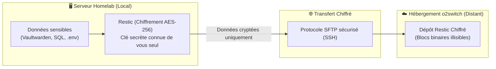

# Guide : Sauvegarde Distante Chiffrée (Zero-Knowledge) vers o2switch via SFTP & Restic

Ce guide décrit la mise en place d'une sauvegarde externalisée automatique et chiffrée de bout en bout de vos données sensibles (Vaultwarden, bases de données Nextcloud / PhotoPrism, fichiers de configuration Docker et Home Assistant) vers votre hébergement **o2switch**.

---

## 1. Principe de Confidentialité Absolue (Zero-Knowledge)

La règle fondamentale de cette sauvegarde est le **chiffrement côté client** :



* **Impossible à lire pour o2switch :** Vos fichiers sont chiffrés sur le NAS **avant** d'être envoyés. Sur votre espace o2switch, aucun fichier n'apparaît en clair : il n'y a que des blocs chiffrés impossibles à ouvrir ou à lire, même pour les administrateurs d'o2switch.
* **Déduplication & Vitesse :** Restic n'envoie que les nouveaux blocs modifiés. Les sauvegardes quotidiennes ne prennent que quelques secondes et consomment très peu de bande passante et d'espace disque.

---

## 2. Prérequis sur le NAS & o2switch

### Étape A : Installer Restic sur le NAS
Connectez-vous en SSH sur votre NAS OMV :
```bash
sudo apt update && sudo apt install -y restic
```

### Étape B : Générer une clé SSH pour la connexion sans mot de passe vers o2switch
Pour que le script s'exécute automatiquement la nuit sans intervention humaine :

1. Générez une paire de clés Ed25519 sur le NAS :
   ```bash
   sudo ssh-keygen -t ed25519 -f /root/.ssh/id_o2switch -N ""
   ```

2. Affichez la clé publique générée :
   ```bash
   sudo cat /root/.ssh/id_o2switch.pub
   ```

3. Dans votre espace **cPanel o2switch** :
   * Allez dans **Sécurité > Accès SSH**.
   * Cliquez sur **Gérer les clés SSH > Importer une clé**.
   * Collez le contenu de la clé publique dans le champ **Clé publique**, donnez-lui un nom (ex: `homelab_nas`) puis validez.
   * Cliquez ensuite sur **Gérer l'autorisation** à côté de votre clé importée et cliquez sur **Autoriser (Authorize)**.

4. Testez la connexion depuis votre NAS :
   ```bash
   sudo ssh -i /root/.ssh/id_o2switch -p 22 votre_user@votre_serveur.o2switch.net
   ```
   *(Si la connexion réussit sans demander de mot de passe, tapez `exit`).*

---

## 3. Configuration du Script

1. Copiez le fichier d'exemple vers `/etc/homelab-restic.env` :
   ```bash
   sudo cp /srv/docker/scripts/restic.env.example /etc/homelab-restic.env
   sudo chmod 600 /etc/homelab-restic.env
   ```

2. Éditez le fichier avec vos accès réels :
   ```bash
   sudo nano /etc/homelab-restic.env
   ```
   Remplissez :
   * `RESTIC_PASSWORD` : Choisissez une phrase secrète très solide (ex: 20+ caractères aléatoires). **Notez-la dans votre coffre de secours : sans elle, vos données sont définitivement perdues !**
   * `SFTP_USER` : Votre nom d'utilisateur cPanel o2switch.
   * `SFTP_HOST` : L'adresse de votre serveur o2switch (ex: `monnom.o2switch.net`).
   * `SFTP_PORT` : Le port SSH (généralement `22`).
   * `SFTP_PATH` : Dossier sur votre compte o2switch (ex: `/home/votre_user/backups_homelab`).

---

## 4. Initialisation du Dépôt Restic (Une seule fois)

1. Ajoutez l'alias SSH pour Restic dans `/root/.ssh/config` :
   ```bash
   sudo tee -a /root/.ssh/config << 'EOF'

Host o2switch-backup
    Hostname votre_serveur.o2switch.net
    User votre_user_cpanel
    Port 22
    IdentityFile /root/.ssh/id_o2switch
    StrictHostKeyChecking accept-new
EOF
   sudo chmod 600 /root/.ssh/config
   ```

2. Initialisez le dépôt chiffré :
   ```bash
   export RESTIC_PASSWORD='VOTRE_MOT_DE_PASSE_CHOISI'
   sudo -E restic -r sftp:o2switch-backup:/home/votre_user_cpanel/backups_homelab init
   ```

   > [!IMPORTANT]
   > Entourez toujours votre mot de passe de **simples apostrophes `'...'`** pour éviter que Bash n'interprète d'éventuels caractères spéciaux (comme les points d'exclamation `!`).

Restic va créer l'arborescence chiffrée sur votre hébergement o2switch.

---

## 5. Gestion du Pare-feu o2switch & Adresses IP Dynamiques (Box FAI)

Par défaut, le pare-feu d'o2switch filtre les connexions SSH entrantes sur le port 22 pour prévenir les attaques par force brute.

### Comment autoriser votre NAS :
1. Dans votre **cPanel o2switch**, rendez-vous dans l'outil **« Autorisation SSH »** (rubrique *Outils o2switch* / *Sécurité*).
2. Cliquez sur **« Ajouter une autorisation »** :
   * **Pour un test immédiat :** Renseignez l'adresse IP publique actuelle de votre NAS (trouvée via `curl -s https://api.ipify.org`), port `22`, connexion entrante.
   * **Pour une IP dynamique (Swisscom / Livebox / Freebox) :** Renseignez le nom de domaine dynamique de votre box (ex: `votre_box.internet-box.ch` ou votre sous-domaine DynDNS/No-IP). Le pare-feu o2switch résout dynamiquement le nom d'hôte et autorise votre IP même après renouvellement !

---

## 6. Tester la Sauvegarde Manuellement

Lancez le script une première fois pour vérifier son bon déroulement :

```bash
sudo /srv/docker/scripts/backup_offsite_restic.sh
```

À la fin de la sauvegarde :
1. Vos bases de données (Nextcloud, PhotoPrism), votre coffre Vaultwarden et vos configurations sont chiffrés et transmis.
2. Une notification push **ntfy** s'affiche instantanément sur votre smartphone sur le topic `homelab-backups`.

---

## 7. Automatisation Quotidienne (Cron)

Pour automatiser la sauvegarde chaque nuit à **03h00** (1h avant Watchtower qui tourne à 04h00) :

1. Ouvrez le planificateur crontab root :
   ```bash
   sudo crontab -e
   ```

2. Ajoutez la ligne suivante à la fin du fichier :
   ```cron
   0 3 * * * /srv/docker/scripts/backup_offsite_restic.sh >> /var/log/homelab_restic_backup.log 2>&1
   ```

3. Sauvegardez et quittez. Votre homelab est désormais protégé contre tout sinistre physique !

---

## 8. Comment Restaurer en Cas de Sinistre Total ?

Si votre NAS venait à brûler ou à être volé :

1. Sur n'importe quelle machine Debian/Ubuntu avec Restic :
   ```bash
   restic -r "sftp:votre_user@votre_serveur.o2switch.net:/home/votre_user/backups_homelab" snapshots
   ```
2. Restic vous demandera votre mot de passe secret et affichera la liste de tous vos points de restauration.
3. Pour tout restaurer :
   ```bash
   restic -r "sftp:votre_user@votre_serveur.o2switch.net:/home/votre_user/backups_homelab" restore latest --target /restauration
   ```
   Toutes vos bases de données, coffres-forts et configurations réapparaissent intacts !
