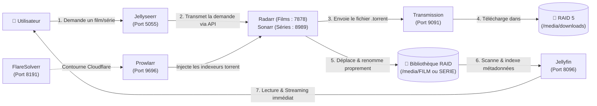

# 🎬 Guide d'Interconnexion Multimédia : Le Workflow Servarr

La suite **Servarr** permet d'automatiser entièrement la chaîne multimédia : de la demande d'un utilisateur sur une interface moderne jusqu'au visionnage en streaming 4K sur la télévision, **sans aucune intervention manuelle**.

---

## 1. Schéma du flux automatisé



---

## 2. Configuration pas-à-pas des liaisons

Grâce au **réseau privé Docker `proxy`**, tous les conteneurs se joignent directement par leur **nom d'hôte** sans avoir besoin de connaître ou figer des adresses IP.

### Étape 1 : Prowlarr (La centrale des trackers)
1. **Ajout des indexeurs** : Dans Prowlarr, allez dans *Indexers* > *Add* (ajoutez vos trackers torrent publics ou privés).
2. **Liaison FlareSolverr (si protection anti-DDoS Cloudflare)** :
   * *Settings* > *Indexers* > *Add Proxy* > Choisissez **FlareSolverr**.
   * Host : `http://flaresolverr:8191` (le nom du conteneur Docker).
3. **Synchronisation automatique vers Radarr et Sonarr** :
   * *Settings* > *Apps* > Cliquez sur **+** et ajoutez **Radarr** :
     * Prowlarr Server : `http://prowlarr:9696`
     * Radarr Server : `http://radarr:7878`
     * Api Key : Collez la clé trouvée dans Radarr (*Settings* > *General* > *API Key*).
     * Sync Level : `Full Sync` *(Dès que vous ajoutez un indexeur dans Prowlarr, il s'injecte automatiquement dans Radarr !)*.
   * Faites la même manipulation pour **Sonarr** (`http://sonarr:8989`).

### Étape 2 : Radarr & Sonarr (Gestion des téléchargements et des dossiers)
1. **Connecter le client de téléchargement (Transmission)** :
   * Dans Radarr/Sonarr : *Settings* > *Download Clients* > **+** > Choisissez **Transmission**.
   * Host : `transmission`
   * Port : `9091`
   * Category : `movies` pour Radarr, `tv` pour Sonarr.
2. **Configurer les chemins de stockage sur le RAID 5** :
   * *Settings* > *Media Management* > Activez le renommage automatique propre (*Rename Movies/Episodes*).
   * Ajoutez le dossier racine cible (*Root Folder*) : `/data/FILM` (pour Radarr) et `/data/SERIE` (pour Sonarr).

### Étape 3 : Jellyseerr (Le portail de requêtes pour vous et vos proches)
1. **Liaison Jellyfin** : Au premier lancement, connectez Jellyseerr à votre serveur :
   * Jellyfin URL : `http://jellyfin:8096`
   * Connectez-vous avec votre compte administrateur Jellyfin pour synchroniser les utilisateurs.
2. **Liaison Radarr** : *Settings* > *Radarr* > *Add Radarr Server* :
   * Host : `radarr` | Port : `7878` | Clé API de Radarr.
   * Cochez le dossier racine par défaut (`/data/FILM`) et le profil de qualité souhaité (ex: *HD-1080p* ou *Any*).
3. **Liaison Sonarr** : *Settings* > *Sonarr* > *Add Sonarr Server* :
   * Host : `sonarr` | Port : `8989` | Clé API de Sonarr.
   * Cochez le dossier racine (`/data/SERIE`) et le profil de qualité.

### Étape 4 : Jellyfin (Indexation & Lecture)
1. Dans le tableau de bord Jellyfin > *Bibliothèques* > *Ajouter une médiathèque* :
   * Type **Films** -> Dossier monté `/data/movies` (pointant vers `/srv/.../media/FILM`).
   * Type **Séries** -> Dossier monté `/data/series` (pointant vers `/srv/.../media/SERIE`).
2. Transmission télécharge, Radarr/Sonarr renomme et organise les fichiers, et Jellyfin met à jour la bibliothèque automatiquement.

---

## 3. Accélération matérielle du transcodage (Intel QuickSync)

Le transcodage logiciel (CPU pur) d'un flux 4K HEVC ou 10-bit sature rapidement les cœurs du processeur hôte (90-100% d'utilisation) et provoque des coupures de lecture. L'activation de l'accélération matérielle via le circuit graphique intégré Intel (iGPU) décharge le CPU et maintient son utilisation sous les 10%.

### 1. Exposition du périphérique de rendu
Dans [`stacks/jellyfin/docker-compose.yml`](../stacks/jellyfin/docker-compose.yml), les périphériques `/dev/dri` sont transmis au conteneur :
```yaml
devices:
  - /dev/dri/renderD128:/dev/dri/renderD128
group_add:
  - "106" # GID du groupe 'render' sur Debian/OMV
```

Pour identifier le GID exact du groupe `render` sur votre machine Debian hôte :
```bash
getent group render | cut -d: -f3
```
Si la commande retourne un identifiant différent de `106` (par exemple `107`), adaptez la valeur dans `group_add`.

### 2. Configuration dans l'interface d'administration Jellyfin
1. Rendez-vous dans **Tableau de bord** > **Lecture** (*Playback*) > onglet **Transcodage**.
2. **Accélération matérielle** : Sélectionnez **Intel QuickSync (QSV)**.
3. **Options de décodage matériel** : Cochez les codecs supportés par votre génération de CPU Intel (typiquement *H264*, *HEVC*, *HEVC 10bit*, *VP9*).
4. Cochez **Activer l'encodage matériel**.
5. Cochez **Activer la mise à l'échelle matérielle VPP** et **Activer le mappage des tons (Tone Mapping)** pour convertir correctement les vidéos HDR vers SDR sur les écrans non-compatibles.
6. Cliquez sur **Enregistrer**.

### 3. Contrôle du fonctionnement
Pour vérifier en temps réel que le processeur graphique intégré est bien sollicité lors d'une lecture :
```bash
sudo apt install -y intel-gpu-tools
sudo intel-gpu-top
```
Lorsqu'un transcodage est actif, le pourcentage sous les colonnes `Video` et `Render/3D` augmente tandis que le CPU reste stable.

---

[← Retour au README principal](../README.md)
