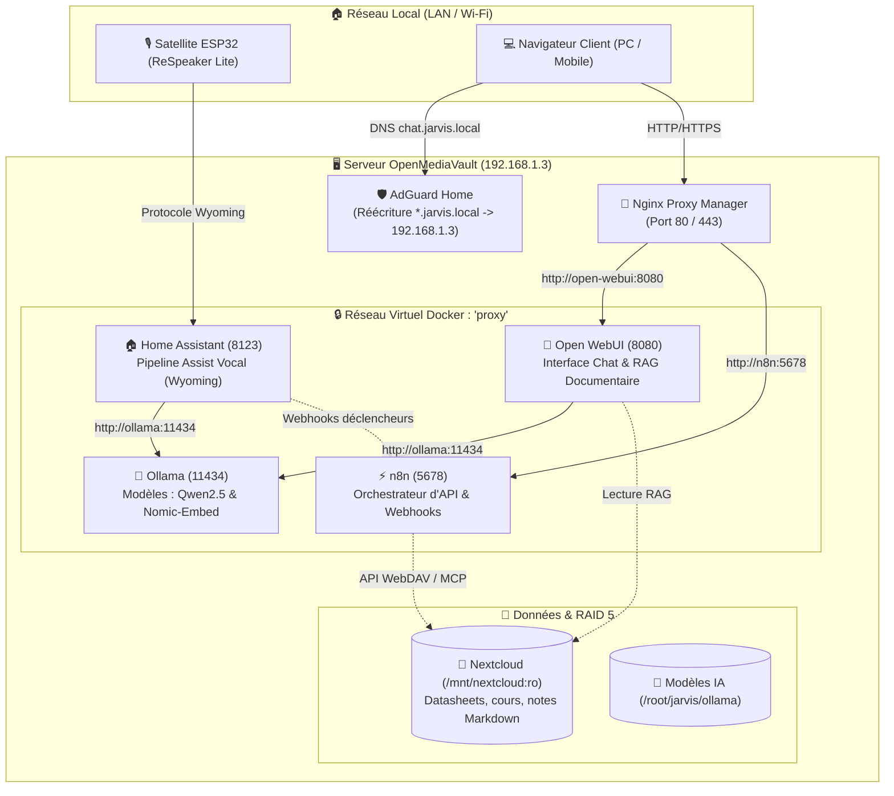

# 🧠 Guide : J.A.R.V.I.S. — Cerveau IA Local (Ollama, Open WebUI, n8n & Home Assistant)

Ce guide détaille la mise en œuvre de l'infrastructure logicielle et réseau pour le projet **J.A.R.V.I.S.**, notre assistant vocal et agentique local auto-hébergé sur le serveur OpenMediaVault.

---

## 1. Architecture des Services Docker

La stack se déploie dans le dossier [`stacks/jarvis/`](../stacks/jarvis/docker-compose.yml) et s'articule autour de 3 conteneurs interconnectés au réseau bridge privé `proxy` :



---

## 2. Configuration DNS dans AdGuard Home

Pour résoudre les noms d'hôtes locaux sans dépendre d'Internet, AdGuard Home sert de résolveur interne.

> [!NOTE]
> **Remarque sur le TLD `.local` vs `.home` / `.lan` :**  
> Selon le standard RFC 6762, l'extension `.local` est réservée au protocole multicast mDNS (Bonjour / Avahi). Sur certains appareils Apple (Mac, iPhone) ou Linux, interroger un domaine en `.local` via un serveur DNS classique peut parfois entraîner une latence de 2 à 5 secondes.  
> Si vous constatez des lenteurs, vous pouvez utiliser au choix **`*.jarvis.local`** ou **`*.jarvis.home`** (ou `*.jarvis.lan`).

### Procédure dans l'interface AdGuard Home :
1. Connectez-vous sur votre panneau AdGuard Home (`http://192.168.1.3:3000`).
2. Rendez-vous dans **Filtres** (*Filters*) > **Réécritures DNS** (*DNS Rewrites*).
3. Cliquez sur **Ajouter une réécriture DNS** :
   * **Domaine** : `*.jarvis.local` (ou `*.jarvis.home`)
   * **Adresse IP** : `192.168.1.3` (l'adresse IP locale de votre serveur NAS)
4. Cliquez sur **Enregistrer**.

Grâce à cette règle wildcard, toutes les adresses suivantes pointeront automatiquement sur Nginx Proxy Manager :
* `chat.jarvis.local` (Interface Open WebUI)
* `n8n.jarvis.local` (Interface d'orchestration n8n)

---

## 3. Configuration dans Nginx Proxy Manager (NPM)

Comme les conteneurs `open-webui` et `n8n` n'exposent aucun port sur l'hôte, Nginx Proxy Manager fait la passerelle via le réseau virtuel `proxy`.

### A. Hôte de Proxy pour Open WebUI :
1. Dans NPM > **Proxy Hosts** > **Add Proxy Host** :
   * **Domain Names** : `chat.jarvis.local`
   * **Scheme** : `http`
   * **Forward Hostname / IP** : `open-webui` (nom du conteneur)
   * **Forward Port** : `8080` *(Attention : Open WebUI écoute en interne sur le port 8080)*
   * Cochez : **Websockets Support**
   * Cochez : **Block Common Exploits**
2. Dans l'onglet **Advanced** *(Indispensable pour le streaming mot par mot en direct)* :
   ```nginx
   proxy_buffering off;
   proxy_cache off;
   chunked_transfer_encoding on;
   ```
   *(Sans ces directives, Nginx met les réponses en mémoire tampon et bloque l'affichage progressif des tokens).*
3. Cliquez sur **Save**.

### B. Hôte de Proxy pour n8n :
1. Dans NPM > **Proxy Hosts** > **Add Proxy Host** :
   * **Domain Names** : `n8n.jarvis.local`
   * **Scheme** : `http`
   * **Forward Hostname / IP** : `n8n` (nom du conteneur)
   * **Forward Port** : `5678` *(Attention : n8n écoute en interne sur le port 5678)*
   * Cochez : **Websockets Support** (indispensable pour l'éditeur de workflows temps réel)
2. Cliquez sur **Save**.

---

## 4. Initialisation des Modèles dans Ollama

Une fois la stack démarrée avec `docker compose up -d`, le moteur Ollama est vide. Il faut télécharger le modèle de langage principal et le modèle de vectorisation RAG.

Connectez-vous en SSH sur le NAS et exécutez :

### 1. Télécharger le modèle d'embeddings (OBLIGATOIRE pour Open WebUI RAG)
Le compose déclare `RAG_EMBEDDING_MODEL=nomic-embed-text:latest`. Téléchargez-le immédiatement :
```bash
docker exec -it ollama ollama pull nomic-embed-text
```

### 2. Télécharger le modèle de conversation / raisonnement (LLM)
Selon la puissance CPU/iGPU de votre serveur OMV :
* **Option A (Recommandée - Excellent en français et supporte les Tools/Fonctions)** :
  ```bash
  docker exec -it ollama ollama run qwen2.5:7b
  ```
* **Option B (Ultra-rapide et léger pour CPU modeste)** :
  ```bash
  docker exec -it ollama ollama run llama3.2:3b
  ```

---

## 5. Connexion avec Home Assistant (Assist vocal)

Pour que votre satellite ESPHome puisse dialoguer avec le cerveau Ollama :

1. Dans Home Assistant : **Paramètres** > **Appareils et services** > **Ajouter une intégration** > chercher **Ollama**.
2. Renseignez les paramètres de connexion :
   * **URL du serveur** : `http://ollama:11434` *(si Home Assistant est sur le réseau Docker proxy)* ou `http://192.168.1.3:11434`
   * **Modèle** : Sélectionnez `qwen2.5:7b` (ou `llama3.2:3b`)
3. Allez dans **Paramètres** > **Voix assistants** > Cliquez sur votre pipeline **Assist** :
   * Dans **Moteur de conversation**, remplacez l'agent standard par votre modèle **Ollama**.
   * Cochez l'autorisation pour l'agent de **contrôler les appareils de la maison** (lumières, prises, scènes de l'atelier).

---

## 6. Exploitation du RAG Nextcloud dans Open WebUI

Dans [`stacks/jarvis/docker-compose.yml`](../stacks/jarvis/docker-compose.yml), les données Nextcloud sont montées en lecture seule :
`- /srv/dev-disk-by-uuid-.../nextcloud:/mnt/nextcloud:ro`

1. Ouvrez votre navigateur sur `http://chat.jarvis.local`.
2. Créez votre compte administrateur initial.
3. Rendez-vous dans **Espace de travail** (*Workspace*) > **Documents** :
   * Vous pouvez indexer directement des fichiers PDF (datasheets composants, manuels) ou des dossiers de notes Markdown.
   * Open WebUI va découper les documents et les vectoriser grâce à `nomic-embed-text`.
4. Dans le chat, tapez `#` suivi du nom du document ou de la collection pour interroger J.A.R.V.I.S. sur vos notes techniques personnelles.

---

## 7. Automatisation avec n8n : Exemple du Briefing Cybersécurité Quotidien

Dans l'architecture J.A.R.V.I.S., **n8n** joue le rôle des bras et des jambes de l'IA : il écoute des événements (plages horaires, flux RSS, webhooks Nextcloud ou Home Assistant), déclenche Ollama pour synthétiser les informations, et diffuse le résultat (Email, Telegram, notification HA).

Un workflow complet et prêt à l'emploi est disponible dans [`stacks/jarvis/workflows/cybersecurity_briefing_workflow.json`](../stacks/jarvis/workflows/cybersecurity_briefing_workflow.json).

### Ce que fait ce workflow automatiquement chaque matin à 07h00 :
1. **Schedule Trigger** : Déclenchement automatique chaque jour à 07h00.
2. **Collecte RSS** : Récupère les derniers articles de *The Hacker News* et les avis d'alerte officiels du *CERT-FR*.
3. **Agrégation & Filtrage** : Sélectionne les 7 actualités les plus récentes.
4. **Synthèse IA locale (Ollama)** : Envoie le texte à `qwen2.5:7b` en interne (`http://ollama:11434`) pour traduire, analyser et formater un briefing clair en HTML (vulnérabilités critiques, cyberattaques, recommandations).
5. **Envoi Email (SMTP)** : Envoie le rapport directement dans votre boîte mail.

### Comment l'importer dans n8n en 30 secondes :
1. Connectez-vous sur votre interface n8n (`http://n8n.jarvis.local`).
2. Créez un nouveau workflow (*Add workflow*).
3. Cliquez sur les **3 petits points en haut à droite** > **Import from File...** (ou copiez-collez le contenu JSON de [`cybersecurity_briefing_workflow.json`](../stacks/jarvis/workflows/cybersecurity_briefing_workflow.json)).
4. Double-cliquez sur le nœud **Envoi du Mail (SMTP)** :
   * Renseignez vos identifiants d'envoi SMTP (votre adresse Gmail, Infomaniak, etc.) et votre adresse email de réception.
5. Cliquez sur **Save** et passez le workflow en mode **Active**.

---

## 8. Roadmap d'Intégration du Projet

| Phase | Objectif | Statut |
| :--- | :--- | :---: |
| **Phase 1** | Déploiement de la stack logicielle Docker (`ollama`, `open-webui`, `n8n`) | ✅ Prêt |
| **Phase 2** | Routage DNS AdGuard (`*.jarvis.local`) & Reverse Proxy NPM (ports 8080 & 5678) | ✅ Opérationnel |
| **Phase 3** | Téléchargement des modèles `qwen2.5:3b`, `qwen2.5:7b` & `nomic-embed-text` | ✅ Opérationnel |
| **Phase 4** | Connexion Home Assistant Assist <-> Ollama (Mode Hybride instantané) | ✅ Opérationnel |
| **Phase 5** | Workflows n8n (Briefing Cybersécurité matinal & connecteurs WebDAV) | 🔄 En cours |
| **Phase 6** | Assemblage matériel du satellite ESPHome (XIAO ESP32-S3 + ReSpeaker Lite + Dum-E) | ⏳ Prochaine étape |

---

[← Retour au README principal](../README.md)
